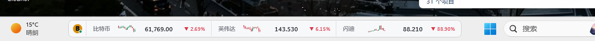

# 币安永续行情任务栏小条



Windows 11 任务栏小工具，显示 Binance USDⓈ-M / TradFi 永续合约的实时价格、24h 涨跌幅和迷你 K 线。

默认标的：

- 比特币：`BTCUSDT`
- 英伟达：`NVDAUSDT`
- 闪迪：`SNDKUSDT`

## 直接运行

双击 `dist\BinanceTaskbar.exe`。这是自包含版本，不需要另外安装 .NET。

## 刷新频率

- 现价：通过 Binance REST 行情接口轮询，默认约每 250ms 刷新一次。
- 24h 涨跌幅：Binance `ticker` 推送，约每秒更新。
- K 线：启动时加载最近的 1m K 线，之后用实时价格持续更新当前 K 线。

## 使用

- 迷你 K 线位于现价左侧。
- 勾选“固定位置”后禁止拖动；取消勾选后可左键拖动并自动保存位置。
- 鼠标右键打开菜单：立即重连、显示 24h 涨跌、配置、重新加载、重置位置、开机启动、隐藏到托盘、退出。
- 托盘图标双击可显示或隐藏。
- 断线后自动重连。

## 配置文件

位置：`%LOCALAPPDATA%\BinanceTaskbar\settings.json`

```json
{
  "symbols": ["BTCUSDT", "NVDAUSDT", "SNDKUSDT"],
  "stocks": [],
  "width": 760,
  "height": 34,
  "leftOffset": 132,
  "topOffset": null,
  "backgroundOpacity": 0.95,
  "theme": "auto",
  "show24hChange": true,
  "positionLocked": true,
  "klineInterval": "1m",
  "klineLimit": 14,
  "priceRefreshMilliseconds": 250
}
```

- `priceRefreshMilliseconds`：行情轮询间隔，最低 200ms，最高 1000ms。
- positionLocked：是否锁定小条位置。	rue 为固定，alse 为可拖动。
- klineInterval：1m、3m、5m、15m、1h、4h、1d。
- 修改后，在右键菜单中选择“重新加载配置”。

## 说明

Windows 11 不允许普通应用真正插入系统任务栏。本工具使用无边框置顶窗口贴靠任务栏空白区域，不会修改系统任务栏。

行情来自 Binance Futures 公共接口，不需要 API Key。网络无法直连 Binance 时，请先配置系统代理或 VPN。


